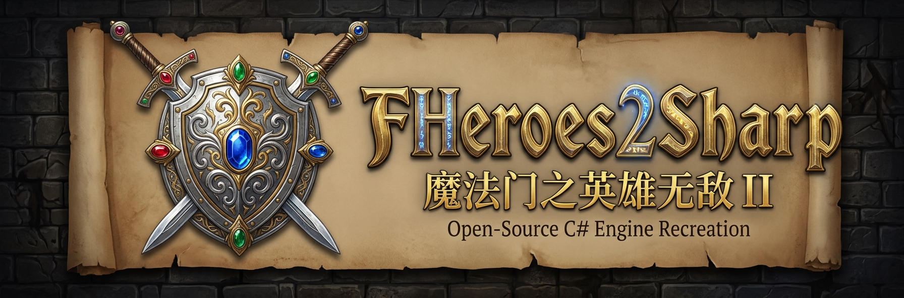

# FHeroes2Sharp

<p align="center">
  
</p>

[](https://github.com/sevencat/FHeroes2Sharp/actions/workflows/ci.yml)

C# / .NET 10 / SDL3 版的《魔法门之英雄无敌 II》引擎重制，移植自
[fheroes2](https://github.com/ihhub/fheroes2)（C++，GPLv2）。

* 平台：**仅 Windows x64**（Win10/11）。客户端项目固定 `win-x64` 运行时标识符，原生 SDL3 /
  SDL3_ttf 按它解析，非 Windows 或 32 位进程启动时直接报错退出（ADR-025）；
  exe 图标与窗口图标来自同一份 `assets/logo.ico`（`AssetProbe` 等工具不受此限制）。
* 目标框架：**.NET 10**（`net10.0`），渲染后端 **SDL3 3.4（SDL3-CS 绑定）**，
  诊断文本使用 **SDL3_ttf**（FreeType，支持中文）。
* 游戏界面文本：原版 `FONT.ICN` / `SMALFONT.ICN` 位图字体（`BitmapFont`）；CJK 等 ICN 表外的字符由
  `TrueTypeGlyphSource` 补位，光栅化用纯托管的 `Sevencat.GlyphRaster`（内嵌文泉驿微米黑，见 ADR-019），
  两种字形共用同一套布局（`GlyphText`），由 `CompositeGlyphSource` 分工：位图字体定行高/advance，
  TrueType 只补 ICN 表没有的码位（ADR-021）。文字颜色不是第二套资源：白/黄/灰都是同一份字形过一遍
  `Core.Imaging.PaletteTable`（原版 `PAL::GetPalette` 的索引重映射表，ADR-020），所以中英文混排同色。
* 分辨率：内部逻辑分辨率固定 **640×480**，按整数倍放大并加黑边（默认 2x = 1280×960）。
* 策略：解析层对原版资源格式 **逐字节一致**，工程结构用现代 C# 分层重写。
* 范围：**游戏本体 + 地图编辑器（先只读）**——参考实现 fheroes2 1.1.18 有完整编辑器（`src/fheroes2/editor/`，
  主菜单 EDITOR 按钮进入），因此编辑器有可对拍的 C++ 代码；但一期只做 E1：打开 `.mp2` 并叠加网格 / 光标
  高亮 / 状态栏，**不改 tile、不保存**。改地图请继续用原版编辑器（ADR-039 已更正「参考没有编辑器」的说法，
  范围与理由见 ADR-040）。
* NativeAOT：**暂不作为支持目标**，但已开启 AOT / 裁剪分析器（`IsAotCompatible`，`IL2xxx`/`IL3xxx`
  为错误），代码保持「反射自由」以便将来切换（见 ADR-011）。

## 当前状态

**M0 已完成**：解决方案骨架、AGG 归档解析、调色板加载、640×480 索引帧缓冲、
整数倍呈现、SDL3_ttf 文本、诊断场景（含截图）、AssetProbe 工具。

**M1 已完成**：ICN 精灵与 TIL 图块的逐字节移植解码（含变换层与调色板转换表）、变换层感知的
`sprite` 贴图、单色光标与光标主题/热点、PNG 读写与 BMP 导出、逐像素比对工具（`AssetProbe compare`），
以及钉住真实资源解码结果的摘要测试（当前套件规模 Core 167 + Assets 162 + UI 113 = 442 个测试）。
导出结果已与原版 C++ 实现**逐字节对拍**：`tools/reference` 把引擎源码编成参考导出器，
`tools/scripts/CompareWithReference.ps1` 默认比对 14 个条目 / 1204 个 BMP，全部相同。

**M2 进行中（主菜单已可玩）**：`.mo` 本地化已落地（`Assets.Localization.MoCatalog` 读取 GNU MO 目录，
`translations/zh_CN.po` + `tools/scripts/BuildTranslations.ps1` 生成并安装
`<data>/files/lang/zh_CN.mo`，当前覆盖主菜单 / 设置 / 语言选择 / 快捷键 / 分辨率 / 场景选择共 112 条，
未翻译项回退英文）。文字颜色也已落地：`Core.Imaging.PaletteTable`（原版 13 张索引重映射表）+
`BitmapFont.WithPalette` / `GlyphCoverageRamp.WithPalette`，白/黄/灰文字与 CJK 混排同色（ADR-020）。
界面文本接的是真实字体：`CompositeGlyphSource` 把 `FONT.ICN`/`SMALFONT.ICN` 与内嵌 CJK 字体合成，
`GameFonts` 在启动时装载（ADR-021）。**主菜单已经上屏**：`HEROES.ICN` 背景 + `BTNSHNGL.ICN` 五块招牌
（悬停/按下由 `UI.Widgets.Button` 处理，鼠标命中靠 `PresentationViewport.TryToLogical`），
底部 11 px 状态栏用 `SMALFONT.ICN` 画 `.mo` 译文与语言标记，`F2` 切换中英文（ADR-022）。
灯笼光晕也已接上：`SHNGANIM.ICN` 第 0 帧做灯体、第 1…39 帧每 250 ms 换帧（`Assets.Icn.IcnAnimation`）；
左下角的设置门在光标扫过时发光（`UI.Widgets.DoorHighlight`，画的是同一张表第 18 帧的下半部分）。
右键招牌（或门）会弹出原版的消息框：`UI.Dialogs.FrameBox` 用 `BUYBUILD.ICN` 的左/右两列拼出边框
（顶 99 px + 35 px 切片 × n + 底 81 px），`UI.Dialogs.MessageBox` 在里面画黄色标题与白色正文，
两者都折行居中（ADR-024）。提示框只在右键按住期间存在，与参考实现的 `Dialog::ZERO` 语义一致。
像素回归有了基线门禁：`tests/baselines/menu.png` 入库，`tools/scripts/VerifyMenuBaseline.ps1`
用「冻结动画 + 人造光标」渲染一帧后逐像素比对（状态栏的 FPS/版本号由 `compare --ignore` 排除，ADR-023）。
设置对话框单独入库，而且是**一种语言一份**：`settings.png`（`en`）与 `settings.zh_CN.png`，
`VerifySettingsBaseline.ps1 -Culture <名字>` 自动认出该用哪张（ADR-029）。
CI（`.github/workflows/ci.yml`）跑编译 + 全部测试，并调这些脚本做像素门禁：托管 runner 没有游戏数据，
只校验基线文件本身（PNG 魔数 + 640×480），像素比对留给装了数据的自建 runner（仓库变量
`FHEROES2_RUNNER` + `FHEROES2_DATA`）。
点左下角的门会打开设置对话框：`StandardWindow` 边框 + 黄色标题 + 「标签 / 值」行（两侧自绘箭头，
点左半行取上一个值、右半行取下一个，循环）+ 底部 `SYSTEM.ICN` 的 OK，Enter/OK 应用、Escape 取消。
行文字超出内容区时按 `RowPadding` 裁掉，值的左端也不会越过左内边距，所以长译文不会跑到边框上。
待办：语言选择对话框（剩余清单见 `docs/PROGRESS.md`）。

**M3：地图清单与场景选择**：`Assets.Maps.Mp2FileInfo` 读 MP2 文件最前面的 428 字节信息块
（名字、描述、尺寸、难度、六种颜色的王国/人类/电脑归属、初始种族、胜负条件与参数），
`Assets.Maps.MapCatalog` 照 `Maps::getAllMapFileInfos` 的规则在数据目录与 `Maps/` 子目录里找地图、
丢掉当前玩家数玩不了的图、按场景名排序；`AssetProbe maps` 能一次打出整份清单（本机 112 张可玩，
1 张因为要求 2 名人类玩家被跳过，ADR-032）。点 NEW GAME 招牌会打开原版的场景选择窗口
（`REQSBKG.ICN` 面板 + `REQUESTS.ICN` 图标、五个尺寸筛选、9 行列表 + `ESCROLL.ICN` 滑块、
选中地图的难度与描述、`SYSTEM.ICN` 的 OKAY）；产品徽章是从 `ARTFX.ICN` 6/90/101 帧缩放合成的
（原版 `ICN::MAP_TYPE_ICON` 也是运行时生成）。方向键 / PageUp / PageDown / Home / End 走列表，
Enter 确认、Escape 关闭，Esc 现在会先关模态窗口而不是直接退出。`--open-scenario` 让截图脚本也能
抓到这一屏，`--scenario-select <n>` 还能直接选中第 n 张（列表末尾的中文图靠它拍图）；
`scenario.png` / `scenario.zh_CN.png` 是它的像素基线（ADR-033）。
地图文字由 `Assets.Maps.MapTextCodec` 判编码：ASCII → UTF-8 → GBK（至少 2 个汉字）→ Latin-1，
所以中文图包的「矿山之战」与英文图的「Alteris」在同一个列表里都能读（ADR-034）。
难度选择、`NEW GAME` 的「标准局 / 战役」分叉、进入冒险地图仍在 M4 之前。

**M4 进行中（冒险地图已可走）**：`Assets.Maps.Mp2Map` 读完 MP2 的结构层（tile 20 字节、addon 15 字节、
城堡表、捕获物表、方尖碑计数、信息块、尾部对象 UID），`Game.AdventureMap.TerrainTileSet` 载入
`GROUND32.TIL` 并预生成 4 种 `shape` 翻转，`AdventureMapView` 按「地形 → 地面层 3/1/2/0 → 顶部层」
逐层绘制可见范围（与 `Interface::GameArea::Redraw()` 同序），对象图来自 MP2 文件里的
(ICN 类型, 帧号)，`ObjectSpriteSet` 按需解码并缓存。英雄也已经上屏：颜色与种族从 tile 里的
`MINIHERO` 帧号反解，身体取种族图集（`KNGT32`…`NECR32`）、旗帜取 `<色>-FLAG32`、阴影取 `SHADOW32`，
精灵按 32 px 行带切成「上面 / 本格 / 下面」三段，分别在地面层的影子层之后、四层之后与顶部层之后画，
所以塔楼盖不住英雄的头、英雄又能踩住自己格上的路（ADR-037）。右上角是小地图：144×144 的雷达把每格
压成「地面色 / 山树提亮三档 / 道路 / 英雄王国色」一个像素块，再叠一圈标出当前视口的虚线框，颜色全部
从 tile 字段算出、不依赖对象表（ADR-038）。点 NEW GAME → 选中地图 → OKAY 现在会真的走进这张地图：
方向键按 tile 滚动、`Home` 回左上、`Esc` 回主菜单（ADR-035、ADR-036）。`--map <file>` 直接开一张图、
`--enter-map` 让脚本从菜单一路点进去，`adventure-map.png` 是它的像素基线
（`VerifyAdventureMapBaseline.ps1`）。仍缺：动画帧、超大对象（`tileUnfit`）、地图怪物与船、
雾与路径、界面面板（`ADVBORD` 外壳与 448×448 视口），清单见 `docs/PROGRESS.md`。

**地图编辑器（E1 看得见，E2 改得动地形）**：主菜单右下角有 EDITOR 按钮（位置照参考，普通数据没有那三帧
招牌美术时自绘一块招牌），点它或 `--scene editor [--map <file.mp2>]` 直接进编辑器，不给 `--map` 就打开地图
目录里的第一张。画面整块复用 M4 的渲染，所以地形、对象、英雄、小地图与游戏里完全一致；编辑器自己加的是
tile 网格（`G` 开关）、光标所在格的双线高亮、顶部 `MAP EDITOR` 工具条与底部状态栏——状态栏会报出光标下的
`x,y`、地面类型（`MapGround`）与对象类型。

E2 起可以**真的改地形**：左键刷、右键按住拖动地图、右键单击当吸管（取光标下的地面），`1`～`9` 选水面到海滩，
`Ctrl+Z` / `Ctrl+Y` 撤销重做——一次按下到抬起算一步，来回刷同一格也只算一步；小地图在结笔后重烤。刷出来的
是每种地面的「纯图块」，**还没有与四邻自动接缝**，所以边缘是硬的（ADR-041）。对象仍不能放、不能删，
**也不能保存**（E3）。

编辑器自己的工具条文字暂用英文常量，因此只有一份基线 `editor.png`（`VerifyEditorBaseline.ps1`，里面带一次
脚本化笔刷 `--editor-paint`）；方向键、滚轮、边缘滚动、`Home`、`Esc` 与冒险地图同一套。

音频：主菜单上屏后循环播原版主菜单曲（`MUSIC/homm2_41.ogg`），音效走 `HEROES2.AGG` 里的
`*.82M`。没有声卡、或缺 `MUSIC/` 目录时只记一条日志，客户端照常运行；`--no-audio` 完全静音，
`--play-sound PICKUP01` 单独试一个音效。

## 快速开始

```powershell
# 需要本机已安装原版游戏数据（本项目不附带任何游戏资源）
dotnet build FHeroes2Sharp.slnx
dotnet test  FHeroes2Sharp.slnx

# 运行客户端（自动探测数据目录，也可显式指定）
dotnet run --project src/FHeroes2.App -- --data "F:\game\fh2"

# 主菜单默认上屏；按键：ESC 退出、F2 切换中英文、N/L/H/C/Q 选招牌、F11 全屏、F12 截图
dotnet run --project src/FHeroes2.App -- --data "F:\game\fh2" --lang zh_CN
dotnet run --project src/FHeroes2.App -- --data "F:\game\fh2" --scene diagnostics

# 地图编辑器（E2 可改地形）：左键刷、右键拖、右键单击吸管、1~9 选地面、Ctrl+Z/Y 撤销重做
# G 切网格、方向键/滚轮滚动、Home 回左上、ESC 退出
dotnet run --project src/FHeroes2.App -- --data "F:\game\fh2" --scene editor
dotnet run --project src/FHeroes2.App -- --data "F:\game\fh2" --scene editor --map "F:\game\fh2\maps\Alteris.mp2"

# 脚本化笔刷（截图按不动鼠标）：在 (50,50) 起刷 8x5 的雪地，然后截图
dotnet run --project src/FHeroes2.App -- --data "F:\game\fh2" --scene editor --editor-paint "50,50,8,5,Snow" --smoke-frames 8 --screenshot painted.png

# 渲染 40 帧后截图退出（CI / 回归用）；--cursor 定格 hover 态
dotnet run --project src/FHeroes2.App -- --smoke-frames 40 --screenshot out.png
dotnet run --project src/FHeroes2.App -- --smoke-frames 40 --cursor 230,210 --screenshot hover.png

# 右键提示框只存在于按住期间，所以抓图要人造光标 + --right-button
dotnet run --project src/FHeroes2.App -- --smoke-frames 40 --cursor 520,230 --right-button --screenshot tip.png

# --left-click 在人造光标处点一下左键：用来验证「点招牌 → 进编辑器」这条只有鼠标能走的路径
dotnet run --project src/FHeroes2.App -- --data "F:\game\fh2" --cursor 565,380 --left-click --smoke-frames 20 --screenshot editor-from-menu.png

# 资产归档检查
dotnet run --project tools/FHeroes2.AssetProbe -- info
dotnet run --project tools/FHeroes2.AssetProbe -- extract KB.PAL kb.pal

# 导出精灵 / 图块为 PNG（默认调色板 KB.PAL，可用 --palette 指定）
dotnet run --project tools/FHeroes2.AssetProbe -- sprites HEROES.ICN tools-output/heroes
dotnet run --project tools/FHeroes2.AssetProbe -- tiles GROUND32.TIL tools-output/tiles

# 导出单色光标；--format bmp 改成 8 bit 索引位图（--background 指定透明处的调色板索引）
dotnet run --project tools/FHeroes2.AssetProbe -- cursor ADVMBW01.BMP tools-output/cursor
dotnet run --project tools/FHeroes2.AssetProbe -- sprites ADVMCO.ICN tools-output/advmco --format bmp --background 23

# 逐像素比对两个 PNG 文件或两个目录（0 = 全同、3 = 有差异）
dotnet run --project tools/FHeroes2.AssetProbe -- compare tools-output/tiles tools-output/tiles-ref

# 列出可玩的地图（读 MP2 文件头：名字、尺寸、难度、玩家颜色、胜负条件）
dotnet run --project tools/FHeroes2.AssetProbe -- maps

# 与原版 C++ 实现逐字节对拍（需要 MSYS2 UCRT64 的 g++ 与一份 fheroes2 源码，见 docs/MISC.md）
pwsh tools/scripts/BuildReferenceTool.ps1
pwsh tools/scripts/CompareWithReference.ps1

# 主菜单像素基线门禁：渲染一帧与 tests/baselines/menu.png 逐像素比对（0 = 一致）
pwsh tools/scripts/VerifyMenuBaseline.ps1
pwsh tools/scripts/VerifyMenuBaseline.ps1 -Update      # 有意改了视觉后重建基线

# 设置对话框基线：一种语言一份（settings.png / settings.zh_CN.png），-Culture 决定用哪张
pwsh tools/scripts/VerifySettingsBaseline.ps1
pwsh tools/scripts/VerifySettingsBaseline.ps1 -Culture zh_CN
pwsh tools/scripts/VerifySettingsBaseline.ps1 -Culture zh_CN -Update

# 场景选择窗口基线：点 NEW GAME 打开的那一屏（--open-scenario 让脚本也能抓到它）
pwsh tools/scripts/VerifyScenarioBaseline.ps1
pwsh tools/scripts/VerifyScenarioBaseline.ps1 -Culture zh_CN
pwsh tools/scripts/VerifyScenarioBaseline.ps1 -Culture zh_CN -Update

# 编辑器基线：--scene editor + 合成光标，居中到地图中心（地形 + 网格 + 高亮 + 工具条 + 状态栏）
pwsh tools/scripts/VerifyEditorBaseline.ps1
pwsh tools/scripts/VerifyEditorBaseline.ps1 -Update           # 有意改了视觉后重建基线

# 冒险地图基线：--map 直接开 Alteris.mp2，居中到地图中部的城堡（地形 + 对象层 + 英雄层 + 小地图）
pwsh tools/scripts/VerifyAdventureMapBaseline.ps1
pwsh tools/scripts/VerifyAdventureMapBaseline.ps1 -MapFile 'D:\HoMM2\maps\Beltway.mp2'
pwsh tools/scripts/VerifyAdventureMapBaseline.ps1 -Update      # 有意改了视觉后重建基线

# 编译语言包（translations/*.po → <data>/files/lang/*.mo，需要 GNU gettext 的 msgfmt）
pwsh tools/scripts/BuildTranslations.ps1
pwsh tools/scripts/BuildTranslations.ps1 -Cultures zh_CN -NoInstall   # 只校验，不安装

# 程序图标：assets/logo.png → assets/logo.ico（exe 图标 + 窗口图标共用这一份）
pwsh tools/scripts/GenerateAppIcon.ps1
```

数据目录解析顺序：`--data` → 环境变量 `FHEROES2_DATA` → 可执行文件目录（及其 `Data` 子目录）
→ 开发机常见安装位置（`F:\game\fh2` 等）。

## 目录结构

```
src/FHeroes2.Core        几何、随机数、二进制 IO、图像缓冲、日志（无外部依赖）
src/FHeroes2.Assets      AGG 归档、调色板/资源定位（依赖 Core）
src/FHeroes2.Rendering   呈现接口、文本抽象（依赖 Core）
src/FHeroes2.Game        游戏世界、回合、AI、存档（依赖 Core/Assets/Rendering）
src/FHeroes2.UI          对话框栈与控件（依赖 Game/Rendering/Core）
src/FHeroes2.App         SDL3 宿主、呈现、字体、场景
tests/…                  xunit 测试
tools/FHeroes2.AssetProbe    归档检查工具
tools/reference          参考引擎导出器（C++，链接 fheroes2 源码）
tools/scripts            调色板表生成、程序图标生成、参考导出器编译、参考对拍、语言包编译、像素基线脚本
tests/baselines          入库的回归基线 PNG（menu.png + settings*.png + scenario*.png + adventure-map.png + 说明）
translations/            语言包源文件（.po）；编译产物 .mo 安装到数据目录，不入库
assets/                  logo.png / logo.ico（图标源图与生成物）、banner.jpg、author.jpg、可再分发字体
docs/                    计划、进度、决策与参考笔记
```

依赖方向单向：`Core ← Assets ← Rendering`；`Game` 依赖 Core/Assets/Rendering，`UI` 依赖 Core/Rendering/Game；
客户端引用全部。任何反向引用都会破坏可测试性（`Core` 里不允许出现 SDL 或 XNA 类型）。

## 文档

* [docs/PLAN.md](docs/PLAN.md) — 里程碑计划
* [docs/PROGRESS.md](docs/PROGRESS.md) — 逐里程碑完成情况与验证记录
* [docs/ARCHITECTURE.md](docs/ARCHITECTURE.md) — 分层、数据流、线程与资源模型
* [docs/DECISIONS.md](docs/DECISIONS.md) — 关键技术决策（ADR 风格）
* [docs/REFERENCE.md](docs/REFERENCE.md) — C++ 源码对照表（文件/类 → C# 类型）
* [docs/MISC.md](docs/MISC.md) — 构建约定、坑位记录、数据依赖测试说明
* [docs/OTHER.md](docs/OTHER.md) — 许可、资源归属、后续想法

## 作者

<p align="left">
  
</p>

[sevencat](https://github.com/sevencat) 发起并维护本项目：负责 C# 侧的分层设计、与原版
fheroes2 逐字节对拍的工具链，以及每个里程碑的落地。移植参考实现为 GPLv2 的
[fheroes2](https://github.com/ihhub/fheroes2)，欢迎 issue 与 PR。

## 许可

本项目为 GPLv2（与原版 fheroes2 一致），**不包含**任何原版游戏资源；
运行需要玩家自备正版《英雄无敌 II》。原版位图字体、`.agg`、`.h2d` 等资源永远不会进入仓库。
